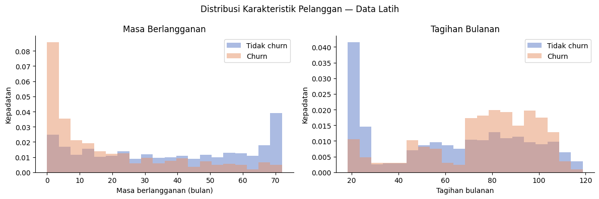

# 📉 Telco Customer Churn Prediction

End-to-end Machine Learning project untuk memprediksi churn pelanggan telekomunikasi, melakukan optimalisasi decision threshold untuk program retensi, serta menyediakan aplikasi web interaktif berbasis Streamlit.

[](https://www.python.org/)
[](https://scikit-learn.org/)
[](https://xgboost.readthedocs.io/)
[](https://streamlit.io/)

---

## 📌 Ringkasan Proyek

Mempertahankan pelanggan lama jauh lebih hemat biaya daripada mengakuisisi pelanggan baru. Proyek ini bertujuan mengidentifikasi pelanggan telekomunikasi yang berisiko tinggi berhenti berlangganan (*churn*), sehingga tim retensi dapat mengambil tindakan pencegahan secara proaktif.

### Highlight Hasil:
- **Model Terbaik:** **XGBoost** (AP 0,6722 pada 5-Fold Stratified Cross-Validation).
- **Threshold Tuning:** Menyesuaikan ambang batas klasifikasi dari default `0,50` ke `0,2744` untuk memprioritaskan **High Recall (Target ≥ 80%)** agar meminimalisir pelanggan churn yang terlewat.
- **Evaluasi Akhir (Holdout Test Set):**
  - **ROC-AUC:** `0,8478`
  - **Average Precision (PR-AUC):** `0,6693`
  - **Recall:** `79,14%` (berhasil mendeteksi 296 dari 374 pelanggan churn)
  - **Precision:** `51,21%`

---

## 📊 Temuan Utama EDA

Eksplorasi data latih (5.634 sampel) mengungkapkan beberapa faktor signifikan terkait retensi:
1. **Jenis Kontrak:** Pelanggan dengan kontrak *Month-to-month* memiliki tingkat churn tertinggi (**42,75%**), dibandingkan kontrak satu tahun (**11,08%**) dan dua tahun (**2,87%**).
2. **Tenure (Masa Berlangganan):** Pelanggan yang churn cenderung memiliki masa berlangganan lebih singkat (median 10 bulan vs. 38 bulan pada pelanggan loyal).
3. **Monthly Charges (Tagihan Bulanan):** Median tagihan pelanggan churn lebih tinggi ($79,95 vs. $64,40).




---

## ⚙️ Metodologi & Pipeline

1. **Pencegahan Data Leakage:**
   - Pemisahan data latih (80% / 5.634) dan data uji (20% / 1.409) dengan *Stratified Sampling* (`random_state=42`).
   - Imputasi missing values (`TotalCharges`), penskalaan fitur numerik (`StandardScaler`), dan encoding kategorikal (`OneHotEncoder`) dibungkus rapi dalam `ColumnTransformer` scikit-learn dan dipelajari hanya dari data latih pada setiap fold CV.
2. **Perbandingan Model (5-Fold Stratified CV):**
   - **Dummy Classifier (Baseline):** AP `0,2654`
   - **Logistic Regression:** AP `0,6614` | ROC-AUC `0,8461`
   - **Random Forest:** AP `0,6106` | ROC-AUC `0,8204`
   - **XGBoost (Sebelum Tuning):** AP `0,6681` | ROC-AUC `0,8470`
   - **XGBoost (Setelah Tuning):** AP `0,6722` (`max_depth=2`, `min_child_weight=1`, `n_estimators=300`)
3. **Threshold Optimization:**
   - Threshold default (`0,50`) menghasilkan recall hanya `52,91%` (47% churn terlewat).
   - Dengan menganalisis Precision-Recall curve pada prediksi Out-of-Fold (OOF), threshold dioptimasi ke `0,2744` untuk mencapai recall ~80%.

---

## 📈 Evaluasi Akhir (Holdout Test Set)

Evaluasi dilakukan pada 1.409 data uji yang sama sekali belum pernah dilihat oleh model selama proses pelatihan maupun pemilihan threshold:

| Pengaturan Threshold | Accuracy | Precision | Recall | F1-Score | TP | FP | FN | TN | Pelanggan Ditandai |
|:---|:---:|:---:|:---:|:---:|:---:|:---:|:---:|:---:|:---:|
| **Default (0,50)** | 81,19% | 68,86% | 53,21% | 0,6003 | 199 | 90 | 175 | 945 | 20,51% |
| **Optimal (0,2744)** | **74,45%** | **51,21%** | **79,14%** | **0,6218** | **296** | **282** | **78** | **753** | **41,02%** |


> **Trade-off Bisnis:** Menggeser threshold mendeteksi **97 pelanggan churn tambahan** (penurunan false negative dari 175 ke 78), dengan konsekuensi tim retensi perlu menghubungi 41,02% dari total basis pelanggan.

---

## 🚀 Menjalankan Aplikasi Web (Streamlit)

Aplikasi menyediakan form input interaktif 19 fitur pelanggan dengan validasi konsistensi layanan otomatis.

### Cara Menjalankan Secara Lokal:

1. **Clone repository:**
   ```bash
   git clone https://github.com/rafikamindra98/telco-customer-churn-prediction.git
   cd telco-customer-churn-prediction
   ```

2. **Buat dan aktifkan virtual environment:**
   ```bash
   python -m venv .venv
   source .venv/bin/activate  # macOS / Linux
   # atau di Windows PowerShell: .venv\Scripts\Activate.ps1
   ```

3. **Install dependensi & jalankan:**
   ```bash
   pip install -r requirements.txt
   streamlit run app.py
   ```

4. Buka browser pada `http://localhost:8501`.

---

## 📁 Struktur Repositori

```text
telco-customer-churn-prediction/
├── app.py                         # Aplikasi Streamlit interaktif
├── churn_artifacts/               # Pipeline model terlatih & metadata
│   ├── churn_model.joblib         # Bundle pipeline XGBoost + preprocessor
│   ├── metadata.json              # Parameter model & versi dependensi
│   └── test_results.csv           # Hasil evaluasi data uji
├── data/
│   └── README.md                  # Petunjuk dataset sumber (Kaggle)
├── notebooks/
│   └── 01_telco_customer_churn.ipynb # Notebook eksperimen lengkap
├── reports/figures/               # Visualisasi & grafik evaluasi
│   ├── churn_by_contract.png
│   ├── customer_distributions.png
│   └── test_confusion_matrix.png
├── requirements.txt               # Dependensi untuk aplikasi Streamlit
├── requirements-notebook.txt      # Dependensi untuk analisis notebook
├── .gitignore
└── README.md
```

---

## 🔍 Batasan & Pengembangan Lanjutan

1. **Horizon Waktu:** Dataset tidak memiliki timestamp riwayat aktivitas, sehingga model mendeteksi kecenderungan churn secara umum tanpa horizon waktu spesifik (misal: "churn dalam 30 hari").
2. **Kalibrasi Probabilitas:** Output model merupakan skor risiko relatif. Kalibrasi lanjutan (Platt Scaling / Isotonic Regression) dapat diterapkan jika probabilitas absolut dibutuhkan untuk kalkulasi finansial.
3. **Analisis Biaya & Manfaat (Cost-Benefit Matrix):** Dapat dikembangkan lebih lanjut dengan mengintegrasikan estimasi Customer Lifetime Value (CLV), biaya penawaran retensi, dan conversion rate promosi.

---

## 👤 Penulis
**Rafi Kamindra**  
- GitHub: [@rafikamindra98](https://github.com/rafikamindra98)
