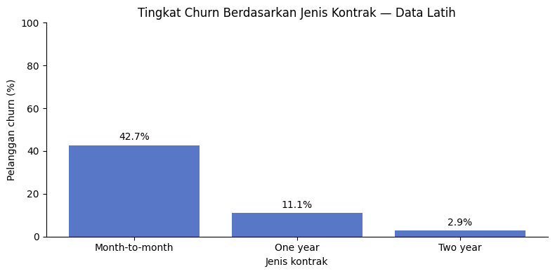
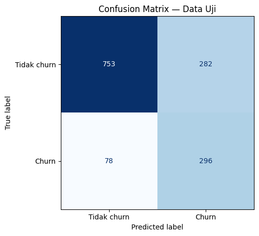

# Telco Customer Churn Prediction

Proyek portofolio klasifikasi pelanggan menggunakan Logistic Regression, Random Forest, dan XGBoost. Aplikasi Streamlit memuat pipeline XGBoost yang telah dievaluasi, bukan melatih ulang model.

## Menjalankan aplikasi

Gunakan Python 3.13 untuk mendekati lingkungan asal model (3.13.16). Buka terminal pada folder yang berisi app.py, kemudian:

```bash
python -m venv .venv
```

Aktifkan lingkungan di macOS/Linux:

```bash
source .venv/bin/activate
```

Atau di Windows PowerShell:

```powershell
.venv\Scripts\Activate.ps1
```

Pasang dependensi dan jalankan:

```bash
python -m pip install -r requirements.txt
python -m streamlit run app.py
```

Versi dependensi model mengikuti metadata yang diekspor dari Colab. Versi Streamlit menggunakan rentang kompatibilitas; belum dikunci melalui instalasi di lingkungan aplikasi. Jika instalasi gagal, simpan pesan error dan periksa ketersediaan paket untuk Python/OS tersebut. Jangan mengganti versi scikit-learn secara sembarang saat memuat model pickle/joblib.

## Data dan metode

- Sumber: https://www.kaggle.com/datasets/blastchar/telco-customer-churn
- 7.043 pelanggan, 21 kolom; target Churn, Yes=1 dan No=0.
- 11 nilai TotalCharges berupa spasi diubah menjadi NaN; semua memiliki tenure=0. Nilainya diimputasi dengan median data latih dalam pipeline.
- customerID dikeluarkan dari fitur. SeniorCitizen diperlakukan sebagai kategori.
- Split stratifikasi 80/20, random_state=42: 5.634 data latih dan 1.409 data uji.
- EDA pada data latih. Imputasi, standardisasi, dan one-hot encoding dipasang dalam pipeline dan dipelajari di setiap fold.
- Perbandingan model dan tuning menggunakan 5-fold stratified CV; kriteria average precision (AP).
- AP CV awal: dummy 0,2654; Logistic Regression 0,6614; Random Forest 0,6106; XGBoost 0,6681.
- AP CV terbaik setelah tuning: XGBoost 0,6722. Grid terpilih: max_depth=2, min_child_weight=1, n_estimators=300. Parameter lainnya tersimpan dalam pipeline.
- Threshold 0,27435654401779175 dipilih untuk precision OOF tertinggi dengan recall minimal 0,80. Target recall merupakan asumsi demonstrasi.

## Evaluasi akhir

ROC-AUC 0,8478; AP 0,6693. AP merupakan average precision, bukan integrasi trapezoidal kurva PR.

| Pengaturan | Accuracy | Precision | Recall | F1 | TP | FP | FN | TN |
|---|---:|---:|---:|---:|---:|---:|---:|---:|
| Threshold 0,5 | 0,8119 | 0,6886 | 0,5321 | 0,6003 | 199 | 90 | 175 | 945 |
| Threshold terpilih | 0,7445 | 0,5121 | 0,7914 | 0,6218 | 296 | 282 | 78 | 753 |

Threshold terpilih mendeteksi 97 churn tambahan dengan 192 alarm keliru tambahan; 41,02% pelanggan uji ditandai. Model dan threshold tidak diubah berdasarkan hasil uji.

## Batasan

Dataset contoh tidak membuktikan kinerja pada perusahaan atau periode baru. Tidak ada horizon prediksi masa depan yang telah divalidasi. Hubungan EDA bukan bukti kausalitas. Kalibrasi probabilitas, dampak ekonomi, efektivitas intervensi retensi, dan evaluasi fairness belum dilakukan. Model menerima informasi demografi; kelayakan penggunaannya perlu dinilai sebelum aplikasi nyata. Tuning dan pemilihan threshold menggunakan data pengembangan yang sama, sehingga angka pengembangan bukan estimasi independen; data uji disisihkan untuk evaluasi akhir. Threshold tidak menjamin recall 80% pada data baru.

Aplikasi memberi skor 0–1, bukan probabilitas terkalibrasi atau kepastian churn. Aplikasi tidak menyimpan input pelanggan ke file. File joblib hanya boleh dimuat dari sumber tepercaya; paket ini memakai model yang diekspor pengguna sendiri.

## Isi paket dan status

- app.py: form 19 fitur dengan pemeriksaan konsistensi layanan telepon/internet.
- requirements.txt: versi library model dari metadata asal.
- churn_artifacts/: model, metadata, dan tabel evaluasi asli.
- notebooks/01_telco_customer_churn.ipynb: notebook dengan penjelasan, kode, output eksperimen asli, dan loader Colab/Kaggle/lokal.
- reports/figures/: grafik asli dari notebook.
- requirements-notebook.txt: dependensi untuk menjalankan analisis.
- data/README.md: petunjuk sumber CSV; data mentah tidak disertakan.
- Pemeriksaan editorial: validasi struktur notebook, parsing semua sel kode, sintaks app.py, serta integritas ZIP.
- Pengguna telah menjalankan aplikasi di Mac dan memperoleh skor 0,5121 pada contoh input dengan threshold 0,274357. Uji imputasi melalui UI belum dikonfirmasi.
- Pelatihan tidak dijalankan ulang dalam penyuntingan ini; hasil notebook berasal dari eksekusi asli pengguna.
- Belum dipublikasikan ke GitHub, Kaggle, atau layanan hosting.


## Notebook dan tampilan hasil

Buka [notebook analisis](notebooks/01_telco_customer_churn.ipynb). Untuk menjalankan analisis lokal, instal requirements-notebook.txt pada lingkungan yang sesuai; di Colab upload CSV bila diminta; di Kaggle tambahkan dataset asal pada input notebook.





## Publikasi portofolio

Nama repository yang disarankan: **telco-customer-churn-prediction**. Upload isi folder proyek, bukan ZIP-nya. Jangan menyertakan folder lingkungan virtual, kredensial, atau CSV mentah. Tidak ada lisensi kode yang dipilih secara otomatis; pemilik dapat menetapkan lisensi yang sesuai. Ketentuan dataset tetap terpisah.

Untuk Kaggle, impor file .ipynb dan tambahkan dataset sumber pada input notebook. Notebook mendeteksi file CSV dari /kaggle/input. Periksa dependensi terlebih dahulu dan jalankan seluruh notebook dari sesi baru sebelum memublikasikan. Jika hasil berubah karena versi lingkungan, laporkan hasil baru secara jujur dan perbarui artefak serta dokumentasi secara konsisten. README ini mencatat run asli, bukan jaminan reproduksi bit-per-bit pada semua lingkungan.

Untuk aplikasi lokal gunakan app.py. Hosting publik merupakan langkah berikutnya; tidak ada deployment publik yang dilakukan oleh paket ini.

## Bantuan AI

Kode dan dokumentasi dikembangkan secara bertahap dengan bantuan AI. Hasil eksperimen berasal dari eksekusi notebook pengguna. Pemilik portofolio perlu memahami dan dapat menjelaskan keputusan metodologi serta keterbatasannya.
